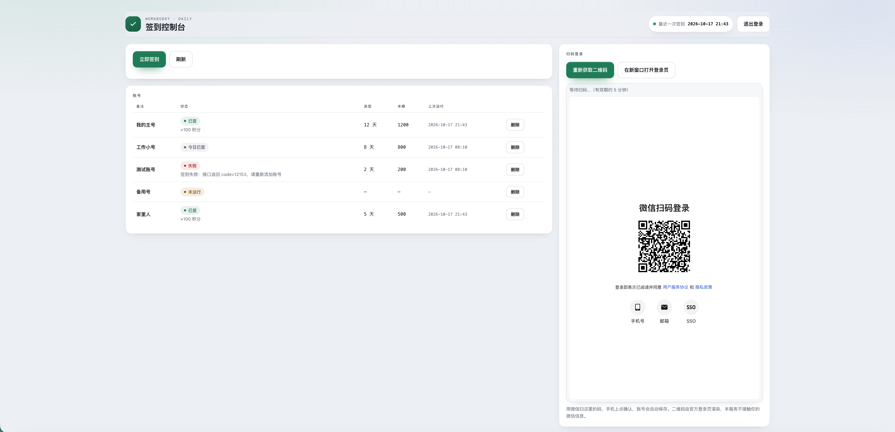

# WorkBuddy 自动签到 —— Cloudflare Worker 版

把每日签到搬到云端：**不用开电脑、不用装客户端、不用第三方文档服务**。微信扫一次码把账号托管进去，之后 Worker 自己续期令牌、按时签到、记录结果。

**代码全在 `worker.js` 一个文件里**——没有构建步骤、没有依赖、没有 import，直接粘贴进 Cloudflare 网页控制台就能跑。

---

## 一、部署（网页控制台，不用装任何东西）

1. 打开 [Cloudflare Dashboard](https://dash.cloudflare.com/) → **Workers & Pages** → **Create**
2. 起个名字，创建后点 **Edit code**
3. 把 `worker.js` 全文粘贴进去 → **Deploy**
4. 回到 Worker 设置页，加三项绑定：

| 类型 | 名称 | 值 |
|---|---|---|
| KV Namespace 绑定 | `WB_KV` | 先到 **Storage & Databases → KV** 新建一个命名空间 |
| Secret | `WB_MASTER_KEY` | 32 字节随机值的 base64（生成方法见下） |
| Secret | `ADMIN_TOKEN` | 你自己定的**页面登录密码** |

可选：Secret `CRON_SECRET`，只有你想改用外部定时器（见第五节）时才需要。

5. **Settings → Triggers → Cron Triggers**，加一条 `10 0 * * *`（= 北京时间 08:10）；想多一次兜底机会再加 `10 16 * * *`（= 次日 00:10）

生成主密钥：浏览器按 F12，控制台执行

```js
btoa(String.fromCharCode(...crypto.getRandomValues(new Uint8Array(32))))
```

> 32 字节的 base64 一定是 **44 个字符、以 `=` 结尾**。不对就是复制漏了。

> `WB_MASTER_KEY` 丢了 = KV 里的令牌全部解不开，只能重新扫码添加账号。**存进密码管理器。**

---



## 二、第一次打开

部署后会拿到一个形如 `https://wb-signin.<你的子域>.workers.dev` 的地址。

1. 打开它 → 输入 `ADMIN_TOKEN` → 点「登录」
2. 登录成功**自动载入账号列表**，看到空列表就是正常

登录状态记在本机浏览器（localStorage），下次打开自动登录，点「立即签到」「刷新」都不用再输密码；公共电脑用完点右上角「退出登录」清除。

---

## 三、添加账号（扫码）

控制台里点 **「获取登录二维码」**：

1. 页面内嵌官方登录页并渲染出二维码（**由官方渲染，本服务不接触你的微信信息**）
2. 用微信扫码 → 手机上点确认
3. Worker 轮询到授权结果 → 令牌加密存进 KV → 账号自动出现在列表里

页面每 2.5 秒轮询一次授权结果，走的和桌面客户端是同一套官方接口（全程 HTTPS）。二维码有效期约 5–6 分钟，超时点「重新获取二维码」即可。

账号的**备注名自动取自账号昵称**，不需要手动填。

> iframe 显示不出来（个别浏览器会拦第三方页面）→ 点 **「在新窗口打开登录页」**，照扫，效果一样。

一个 Worker 可以放多个账号（小号、备用号），互不影响。

---

## 四、控制台

| 区域 | 说明 |
|---|---|
| 顶栏胶囊 | **最近一次签到**：所有账号中最新的那次运行时间；还没跑过则显示「暂无记录」 |
| 立即签到 | 马上跑一轮签到（等同定时任务的逻辑） |
| 刷新 | 重新拉取列表与状态 |
| 退出登录 | 清除本机保存的登录密码，回到登录页 |
| 账号表 | 备注 / 状态 / 连签 / 本期 / 上次运行 / 删除 |

状态标签：

| 标签 | 含义 |
|---|---|
| 已签 | 这次真的签上了（下方会显示 `+N 积分`） |
| 今日已签 | 今天已经签过，没重复加分 |
| 未运行 | 还没跑过 |
| 失败 | 请求出错，下方显示原因 |
| 令牌失效 | 令牌过期或客户端登出过，需要重新扫码添加 |

界面适配：**跟随系统自动切换深色/浅色主题**；宽屏两栏（左账号、右扫码），窄于 1080px 自动变单栏，手机上账号表会退化成卡片式列表。

---

## 五、定时任务

**Cloudflare 的 Cron 表达式只认 UTC。** 下表左列是你要填进 Cloudflare 的表达式，右列是它对应的北京时间：

| 设置 | Cron（填这个，UTC） | 对应北京时间 | 作用 |
|---|---|---|---|
| **必设一条** | `10 0 * * *` | **08:10** | 每天签到（只设这一条就够用） |
| 选填（建议加） | `10 16 * * *` | 次日 **00:10** | 多一次机会，失败时能自动补 |

**只设一条完全够用**：Worker 不区分是哪条 cron 触发的，任何一条到点都会跑同一套签到逻辑，所以每天一次覆盖就够了。第二条的意义在于"一天两次机会"：

- 两条都设时，按时间先后是 **00:10 先签 → 08:10 再确认一次**
- 如果 00:10 那次失败了（列表状态会显示「失败」），08:10 那次会**重试**而不是跳过
- 如果 00:10 已经签成功，08:10 那次会识别为"今日已完成"直接跳过，不发多余请求

> 想签得更早（零点一过就签）也行：只留 `10 16 * * *` 那条，同样能覆盖每天签到。

改时间：在 **Settings → Triggers → Cron Triggers** 里直接改。

> 换算公式：**北京 = UTC + 8**。例如「北京时间早上 9 点」要写成 `0 1 * * *`。

**签到接口幂等**（今天已签会返回 `code=10001`，不会重复加分），所以定时重复触发、手动点「立即签到」、两条 cron 都跑，都安全。

> 部署完别干等：cron 要到点才跑，下午部署完看到列表没动静是正常的——想立刻验证链路就点「立即签到」。

### 改用外部定时器（选填）

不想用 Cloudflare 自带的 cron，或者想把签到并进你已有的定时任务里管理，可以从外面调 `/cron` 接口触发。**它跑的逻辑和「立即签到」完全一样**（今天签过就跳过），所以多触发不会重复加分。

**第 1 步：配口令**

在 Worker 的 **Settings → Variables and Secrets** 里加一个 Secret：

| 名称 | 值 |
|---|---|
| `CRON_SECRET` | 随便一串长随机，例如 `openssl rand -base64 24` 的输出 |

> 不配也能用——这时口令会回落到 `ADMIN_TOKEN`。但建议单独配一个：万一这个口令泄露，换掉它就行，不用动页面登录密码。

**第 2 步：调用**

```bash
# 推荐：口令放请求头，不会留在各种日志和浏览器历史里
curl -X POST "https://wb-signin.你的子域.workers.dev/cron" \
  -H "X-Cron-Secret: 你的CRON_SECRET"
```

```bash
# 也可以放 query（GET / POST 都行）
curl "https://wb-signin.你的子域.workers.dev/cron?key=你的CRON_SECRET"
```

**第 3 步：看返回**

```json
{
  "at": "2026-10-17T08:10:00.000 +08:00",
  "accounts": 2,
  "checked": 1,
  "already": 1,
  "failed": 0,
  "results": [
    { "id": "CSl88KP2yXIn", "label": "我的主号", "state": "checked", "msg": "+100 积分" }
  ]
}
```

- `checked` 这次真签上了，`already` 今天已经签过（跳过），`failed` 失败或令牌失效
- HTTP **401** = 口令不对；**500** = `CRON_SECRET` 和 `ADMIN_TOKEN` 都没配

**第 4 步：接到调度器上**

cron-job.org 之类的服务：新建任务 → URL 填上面的地址 → 频率设成一天一次 → 在自定义请求头里加 `X-Cron-Secret`。

GitHub Actions：

```yaml
on:
  schedule:
    - cron: '0 0 * * *'        # UTC 00:10 = 北京时间 08:10
jobs:
  signin:
    runs-on: ubuntu-latest
    steps:
      - run: |
          curl -fsS -X POST "https://你的地址/cron" \
            -H "X-Cron-Secret: ${{ secrets.CRON_SECRET }}"
```

> 外部调度器的 cron 表达式同样是 **UTC**。GitHub Actions 的定时任务在高峰期可能延迟几分钟到几十分钟——签到不挑时间的话无所谓。

**注意**：这条接口只靠口令保护，别把带 `key` 的地址贴到公开仓库、聊天记录或浏览器地址栏（会留在访问历史里）；怀疑泄露就换一个 `CRON_SECRET`。

> Cloudflare 的 cron 和 `/cron` **二选一即可**，两边都配也不会重复签到。

---

## 六、常见问题

| 现象 | 原因 | 处理 |
|---|---|---|
| 登录提示「登录密码不正确」 | `ADMIN_TOKEN` 填错 | 检查有没有多打空格 |
| 提示 `未配置 ADMIN_TOKEN` | 这个 Secret 没建 | 补建，名字要**完全等于** `ADMIN_TOKEN` |
| 提示 `缺少 WB_MASTER_KEY` | Secret 没建或名字拼错 | 名字要**完全等于** `WB_MASTER_KEY` |
| 提示 `WB_MASTER_KEY 必须是 32 字节` | 主密钥复制不全 | 重新生成，确认 44 字符且以 `=` 结尾 |
| 提示 `WB_MASTER_KEY 不是合法 base64` | 粘进了换行或引号 | 只复制字符串本身 |
| 登录成功但列表报错 | KV 没绑定或绑定名写错 | 绑定名必须**完全等于** `WB_KV` |
| 列表是空的 | 还没添加账号；或 cron 还没到点 | 扫码添加，然后点「立即签到」 |
| 扫码区空白、二维码不显示 | 浏览器拦了第三方 iframe | 点「在新窗口打开登录页」再扫 |
| 提示「登录会话已过期，请重新获取二维码」 | 二维码超过约 5–6 分钟没扫 | 点「重新获取二维码」 |
| 状态显示「令牌失效」 | 很久没跑，或客户端登出过 | 重新扫码添加 |
| 一直没动静 | cron 没配 / 时区搞错 | 检查 Triggers 里那条 cron 是否生效，注意填的是 UTC |
| 外部定时器调 `/cron` 返回 401 | `key` / `X-Cron-Secret` 填错，或没配 `CRON_SECRET` | 口令须等于 `CRON_SECRET`，没配时回落到 `ADMIN_TOKEN` |

排查看实时日志：Worker 详情页的 **Logs**。

---

## 七、安全设计

- KV 里存的是 **AES-256-GCM 密文**，每个账号独立的 salt + IV，KV 中永远不出现明文令牌
- API 任何响应都不返回令牌，连前缀都不给
- 登录密码与账号令牌分离——泄露登录密码不等于泄露账号
- 登录密码只存在浏览器 localStorage，Worker 侧不落盘、不下发 Cookie
- 页面零外部资源引用

> 边界：令牌在 Worker 内存里必然有一刻是明文。云端能看到什么，取决于你是否信任它——介意就部署到自己的账号下。

---

## 八、已知限制

1. **接口是逆向得到的**，客户端升级可能改路径或参数，届时需要跟进适配
2. **只做了签到**，没做成长中心那套（旅行礼物、派 Buddy、开盲盒、连登兑换）——那些接口参数更复杂、变动更频繁
3. **扫码依赖官方登录页**，登录页改版或官方对非客户端来源做限制时可能失效
4. 免费额度绰绰有余：Workers 10 万请求/天，KV 10 万读 / 1 千写 / 天——一天跑两次签到，连零头都用不到

---

## 九、风险提示

本项目为非官方工具，与腾讯 / WorkBuddy 无任何隶属关系。签到接口从桌面端逆向得到，使用风险自负。

自动化签到可能涉及服务条款问题。**建议只给自己的账号用，不要做多账号刷积分**——规模一大更容易被风控识别。项目提供多账号能力是为了方便管理你自己的号，不是鼓励滥用。
